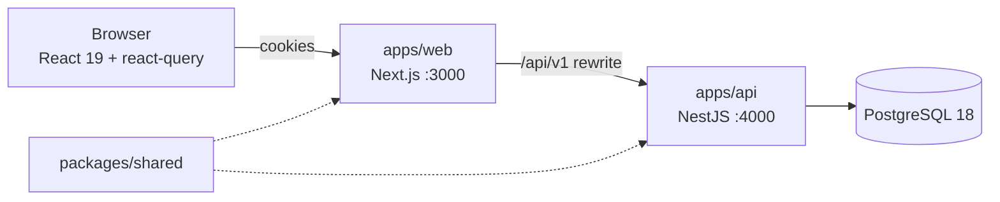

<div align="center">

# DevFlow

**Issue tracking and workflow management for software teams.**

Workspaces → projects → issues, with a role model that actually means something.

[](https://github.com/SSzSun/devflow-management/actions/workflows/ci.yml)
[](https://www.typescriptlang.org/tsconfig#strict)
[](https://bun.sh)
[](https://nestjs.com)
[](https://nextjs.org)
[](https://www.prisma.io)
[](https://www.postgresql.org)
[](https://tailwindcss.com)

</div>

---

DevFlow is a full-stack issue tracker built as a portfolio project: a NestJS
REST API backed by PostgreSQL, and a Next.js App Router frontend with a
responsive board, issue detail view, comments, labels and per-project settings.
It is meant to be read as much as run — every non-obvious rule (authorization,
workflow transitions, token rotation) lives in one place and is covered by a test.

## What you can do

- **Organize** work in workspaces and projects, each project with its own issue
  key (`WEB-42`) and per-project member list.
- **Track** issues across a four-step workflow — `TODO → IN_PROGRESS →
  IN_REVIEW → DONE` — with priority, assignee, due date and labels.
- **Move** cards on a drag-and-drop board (with keyboard-friendly move buttons),
  or filter and sort a paginated list.
- **Discuss** on issue threads with comments, and read an immutable activity
  log of every status, priority and assignee change.
- **Control access** with two role layers: workspace `OWNER`/`ADMIN`/`MEMBER`
  and project `ADMIN`/`MEMBER`/`VIEWER`. Outsiders get a 404, not a hint.
- **Stay signed in** with rotating refresh tokens and CSRF-protected cookies,
  and switch between light and dark themes.

## Tech stack

| Layer | Choice | Why |
| --- | --- | --- |
| Frontend | Next.js 16 (App Router), React 19, Tailwind CSS 4, TanStack Query | Server-rendered shell, client-side data, one design token set |
| Backend | NestJS 12, class-validator, Swagger | Explicit module/guard/service layering; schema generated from DTOs |
| Database | PostgreSQL 18 + Prisma 7 | Real relational constraints for the membership and history model |
| Shared | `packages/shared` TypeScript package | Enums, role ranking and the workflow map used by both sides |
| Tooling | Bun 1.3 workspaces, TypeScript strict, ESLint, Vitest / `bun test` | One lockfile, one runtime, no `any` |

## Architecture



Full write-up: **[docs/architecture.md](docs/architecture.md)** · schema:
**[docs/erd.md](docs/erd.md)** · endpoints: **[docs/api.md](docs/api.md)** ·
interactive Swagger: **`/api/docs`** on the API origin.

## Quick start

### Option A — Docker Compose (whole stack)

```bash
docker compose up --build
```

Then open <http://localhost:3000>. This builds the API and web images, starts
PostgreSQL, waits for the API healthcheck, and serves the production Next.js
build. Set `JWT_ACCESS_SECRET` in the shell to override the local placeholder.

The API container applies migrations on boot. Load the demo data once:

```bash
docker compose exec api bun run seed
```

### Option B — local development

Requires **Bun 1.3+**, **Node 22.12+** and **PostgreSQL 18** (or
`docker compose up -d db` for just the database).

```bash
bun install
cp .env.example apps/api/.env          # then set a real JWT_ACCESS_SECRET

cd apps/api
bunx prisma generate
bunx prisma migrate dev
bun run seed                            # demo workspace, issues and accounts
bun run start:dev                       # API on http://localhost:4000
```

In a second terminal:

```bash
bun run --cwd apps/web dev              # web on http://localhost:3000
```

Sign in at <http://localhost:3000/login>. The web app proxies `/api/v1/*` to
the API, so the session cookies stay first-party.

> The seed is idempotent: it deletes and recreates the `devflow-demo`
> workspace. Re-run it any time to get a clean demo.

### Demo accounts

All demo users share the password **`devflow123`**.

| Email | Workspace role | Project role | Can |
| --- | --- | --- | --- |
| `owner@devflow.test` | OWNER | inherits ADMIN | everything |
| `admin@devflow.test` | ADMIN | ADMIN | settings, members, labels, all issues |
| `member@devflow.test` | MEMBER | MEMBER | create and edit issues, not project settings |
| `viewer@devflow.test` | MEMBER | VIEWER | read and comment, cannot change issues |

Sign in with different accounts side by side to see the permission boundaries.

## Scripts

Run from the repository root:

| Command | What it does |
| --- | --- |
| `bun run dev` | API and web together, in watch mode |
| `bun run build` | Build shared → API → web (production output) |
| `bun run test` | Shared unit tests, API integration tests, web component tests |
| `bun run typecheck` | `tsc --noEmit` for all three packages |
| `bun run lint` | ESLint over the whole workspace |
| `bun run --cwd apps/api seed` | Reset and repopulate the demo workspace |

## Testing

- `packages/shared` — role ranking and allowed status transitions.
- `apps/api/test` — integration tests against a **real PostgreSQL** database,
  using the production guards and pipes: auth rotation, CSRF, cross-workspace
  isolation, workflow rules, soft delete, archived projects.
- `apps/web` — vitest + Testing Library over the API client's refresh-and-replay
  flow and the main screens.

```bash
docker compose up -d db   # integration tests need the database
bun run test
```

## Deployment

Both images build from the **repository root** as context, because the Bun
workspace links `@devflow/shared` into each app:

- `apps/api/Dockerfile` — compiles Prisma and Nest, runs `node dist/main.js`
  as the non-root `node` user on port 4000.
- `apps/web/Dockerfile` — builds Next.js and runs `next start` on port 3000;
  `API_URL` is a **build argument** because `next.config.ts` bakes the
  `/api/v1` rewrite into the build.

`docker-compose.yml` wires them to PostgreSQL with healthchecks and
`depends_on`. For a real environment:

1. Set `JWT_ACCESS_SECRET` (and `CORS_ORIGIN`, only if a browser calls the API
   directly) from your platform's secret store — never the placeholders.
2. Run `bunx prisma migrate deploy` before starting new API containers.
3. Terminate TLS in front of the web container: cookies become `Secure` when
   `NODE_ENV=production`, so plain HTTP will not keep a session.
4. `.github/workflows/ci.yml` runs lint, typecheck, tests against a PostgreSQL
   service, and both builds on every push and pull request.

## Repository layout

```
apps/
  api/     NestJS REST API, Prisma schema + migrations, seed, integration tests
  web/     Next.js App Router app, components, API client, tests
packages/
  shared/  Enums, role ranking, workflow map, sort allowlist
docs/      Architecture, ER diagram, API reference
docker-compose.yml   Dev database + full production-style stack
```

## Known limitations

- The board loads at most 100 issues (the API's max page size) and says so when
  a project has more; a larger deployment would paginate or virtualize columns.
- No email verification, password reset, invitations, attachments,
  notifications or realtime updates. Members are added by the email of an
  existing account.
- One owner per workspace; ownership transfer is not implemented.
- Sessions cannot be listed or revoked individually from the UI; logout revokes
  the refresh token in the current browser.
- The Docker images bundle dev dependencies. Fine at this size; a `standalone`
  Next output and a pruned production install would shrink them.

## Documentation

| Document | Contents |
| --- | --- |
| [docs/architecture.md](docs/architecture.md) | Request lifecycle, authorization model, session strategy, data rules |
| [docs/erd.md](docs/erd.md) | Mermaid ER diagram and index rationale |
| [docs/api.md](docs/api.md) | Every route with its required role, filters, curl walkthrough |
| `/api/docs` | Swagger UI, generated from the running app |

---

Built as a portfolio project. The code is intentionally boring where boring
wins: explicit guards, explicit transactions, explicit error codes.
