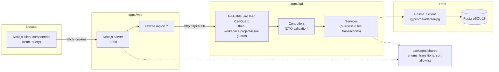

# Architecture

DevFlow is a three-package Bun workspace: a NestJS REST API, a Next.js App
Router frontend, and a shared TypeScript package that holds the enums and
business constants both sides must agree on.

## Why the browser talks to Next.js, not the API

The web app proxies `/api/v1/*` to the API server (see `apps/web/next.config.ts`).
Browser and API therefore share one origin, so the `HttpOnly` session cookies
are first-party and no `SameSite=None` workaround is needed in development or
production. The rewrite target is baked in at build time, which is why the web
image takes `API_URL` as a build argument.

## Request lifecycle

1. **CORS + helmet + cookie parser** are installed in `apps/api/src/main.ts`.
2. **`ThrottlerGuard`** (300 req/min per IP) runs globally; credential
   endpoints tighten this to 10 req/min.
3. **`CsrfGuard`** rejects cookie-authenticated mutations unless
   `X-CSRF-Token` matches the `csrf_token` cookie. Bearer requests are exempt
   because they are not cookie-driven.
4. **`JwtAuthGuard`** verifies the access JWT from the `access_token` cookie
   (or an `Authorization: Bearer` header) and sets `req.userId`.
5. **A scope guard** resolves the caller's effective role:
   `WorkspaceGuard` for workspace routes, `ProjectScopedGuard` for project
   routes, `IssueScopedGuard` for issue routes. It also enforces
   `@Roles()` / `@ProjectRoles()` and the archived-project read-only rule.
6. **`ValidationPipe`** (whitelist + forbidNonWhitelisted + transform) rejects
   unknown or malformed fields before the service sees them.
7. **The service** applies business rules inside `$transaction` where several
   rows must change together.

`PrismaExceptionFilter` is the last resort: an uncaught `P2025`, `P2002` or
`P2003` becomes a 404, 409 or 400 instead of a 500.

## Authorization model

`resolveProjectAccess` (`apps/api/src/common/project-access.ts`) is the single
definition of "what may this user do in this project". In one query it fetches
the project, the caller's workspace membership and their project membership:

| Workspace role | Effective project role |
| --- | --- |
| `OWNER` / `ADMIN` | `ADMIN` (inherited, no `ProjectMember` row needed) |
| `MEMBER` | the role from their `ProjectMember` row, or no access |
| not a member | no access |

Two rules follow from this:

- **No access is a 404, not a 403.** An outsider must not learn that a project
  exists. A project the caller can already see but lacks the role for is a 403.
- **Archived projects are read-only.** Non-`GET` requests return 409 unless
  the route opts out with `@AllowOnArchived()` (archive, restore, and member
  management).

Project roles rank `ADMIN` > `MEMBER` > `VIEWER`; a required role is satisfied
by any role at or above it.

## Session strategy

- **Access token**: JWT in an `HttpOnly` `access_token` cookie, 15 minutes.
- **Refresh token**: random 32 bytes, stored as a SHA-256 hash in
  `RefreshToken`, 7 days. Every refresh rotates it atomically
  (`updateMany ... where revokedAt: null`, must affect exactly one row), so a
  replayed token cannot mint a second session.
- **CSRF token**: a non-`HttpOnly` `csrf_token` cookie, read by JavaScript and
  echoed in the `X-CSRF-Token` header (double-submit). It exists before login
  because `GET /auth/csrf` issues one for anonymous visitors.
- Passwords are hashed with Argon2id. An unknown email still performs a dummy
  Argon2 verify so the response time does not reveal whether the account
  exists.
- Cookies are `SameSite=Lax` and become `Secure` when `NODE_ENV=production`.

## Issue numbering

`ProjectCounter.lastIssueNumber` is incremented with an atomic
`UPDATE ... RETURNING` inside the same transaction that inserts the issue.
Concurrent creates serialize on that row, so `WEB-42` is unique per project
without a retry loop. `@@unique([projectId, number])` is the backstop.

## Soft delete vs archive

- **Issues** are soft-deleted (`deletedAt`): the activity log is the history of
  record and must survive the issue's removal. Guards and list queries filter
  them out.
- **Projects** are archived, never deleted: a cascade delete would destroy every
  issue, comment and activity row. Archived projects are hidden from project
  lists unless `?includeArchived=true`.

## Testing strategy

- API tests are **integration tests against a real PostgreSQL database**
  (`apps/api/test`), using supertest and the real Nest application with the
  same guards and pipes as production. They create their own users and clean up.
- Shared package tests cover role ranking and status-transition rules.
- Web tests (vitest + happy-dom + Testing Library) cover the API client's
  refresh-and-replay behaviour and the main screens' rendering rules.
