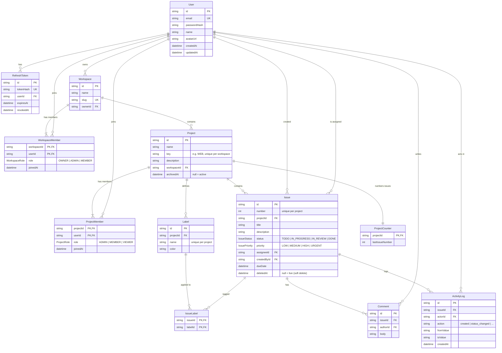

# Database ER diagram

Derived from `apps/api/prisma/schema.prisma`. Migrations live in
`apps/api/prisma/migrations`.

## Notes

- `WorkspaceMember` and `ProjectMember` use composite primary keys
  (`workspaceId, userId`) and (`projectId, userId`), so membership is unique by
  construction.
- `User` sits on both sides of `Issue` twice: `assigneeId` (`onDelete: SetNull`
  — deleting a user unassigns work) and `createdById` (`onDelete: Restrict` —
  authorship must not disappear).
- `Project.archivedAt` and `Issue.deletedAt` are the two "not really gone"
  markers described in [architecture.md](./architecture.md).
- Indexes exist for the query shapes actually used: issues by
  `(projectId, status)`, `(projectId, assigneeId)`, `(projectId, updatedAt)`;
  comments and activity by `(issueId, createdAt)`; `IssueLabel.labelId` for
  label filters.
